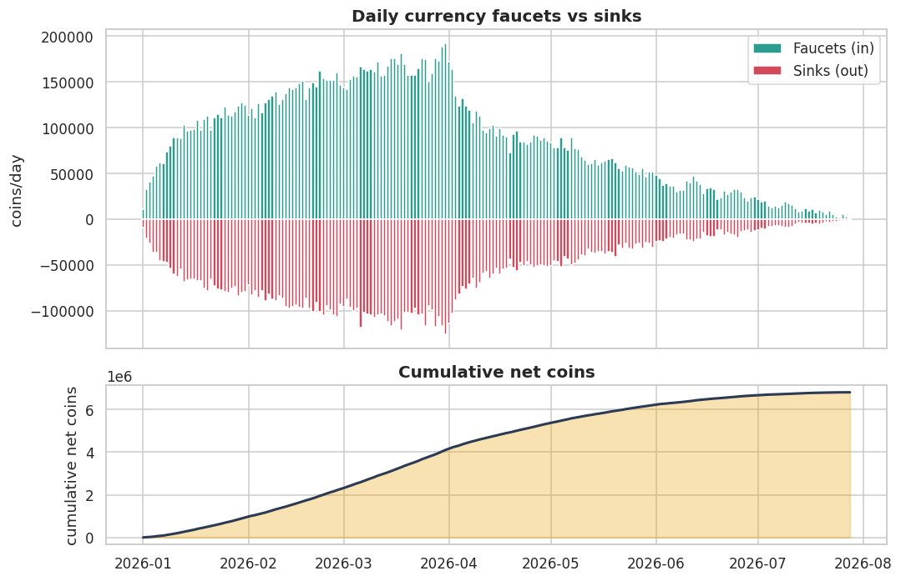
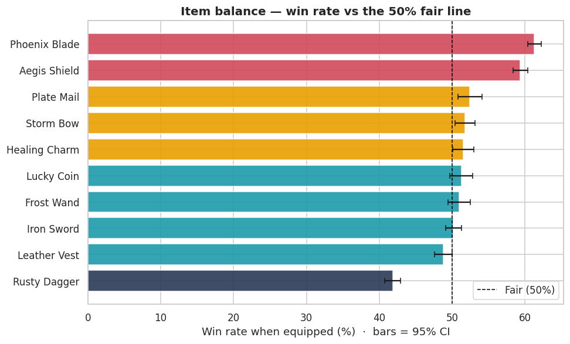
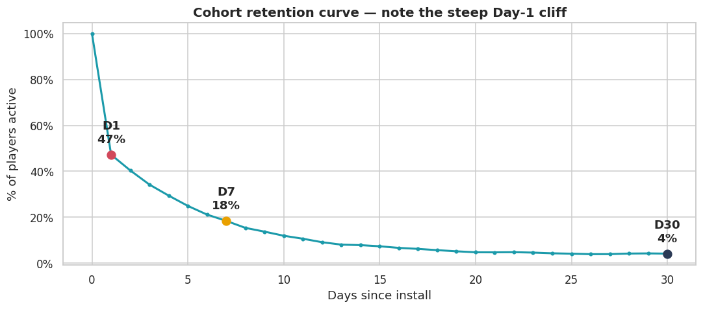

# Project 2 — Free-to-Play Game Economy & Balance Analytics
Portfolio project · SYNTHETIC telemetry · Python + statistics + SQL

## Executive summary (for a non-technical reader)
I built an end-to-end analytics pipeline for a free-to-play game on realistic synthetic telemetry (players, sessions, matches, a soft-currency ledger and purchases). The goal was to answer the three questions a producer cares about: is the economy healthy, are the items fair, and what makes players stay and pay?

Currency sources exceed spending: sinks recover about 63% of coins issued. This measures net coin supply. Measuring purchasing power would require price data.

Two premium items are overpowered by a meaningful margin. Phoenix Blade wins 61.3% of its matches and Aegis Shield 59.4%, both well above the fair 50% line and ≥5 points off it. Because both are paid items, the game reads as mildly pay-to-win. Rusty Dagger is the opposite, an underpowered starter at 41.8%. A few other items test "significantly" above 50% but only by a point or two — with thousands of matches that is statistically detectable yet irrelevant for balance, so I flag effect size, not just the p-value, and label those "skewed (small)" rather than overpowered.

Retention drops hard after the first day: D1 47%, D7 18%, D30 4%. About half of installs never return on day 1, but these exact-day shares do not establish that the same players remain sticky. The first session is a sensible hypothesis to test; the analysis does not measure intervention lift.

Monetization is small and tracks early engagement. Only 5.8% of players ever pay (ARPPU $15.61), and payers log far more early activity. A logistic classifier uses days 0–3 activity to classify first purchases in days 4–30 among 5,982 players who have not paid before day 4. It reaches ROC AUC 0.730 on the synthetic holdout. Average precision is 0.092 versus a 0.028 prevalence baseline. Accuracy at the chosen threshold is 74.7%, versus 97.2% for an always-nonpayer rule.

The resulting plan: add a coin sink, nerf the two pay-to-win items, fix onboarding to attack the D1 drop, and test any targeted offer with a randomized holdout.

> Data label: SYNTHETIC. All telemetry is generated by one seeded script (`data/generate_data.py`). Real F2P telemetry is proprietary and privacy-sensitive, so a reproducible synthetic generator was the practical path (see `NOTES.md`). Because the generator builds in known ground truth — item win rates, the D1 cliff, an engagement→pay link — several headline numbers here *recover values that were designed in*. This project therefore demonstrates that the **pipeline** works (clean → test → model → recommend), not facts about any real game; where a finding just echoes a generation parameter, the write-up says so.

---

## Problem
A game producer needs an evidence-based read on the live game's health across three areas:
1. Economy balance — do currency sources (faucets) match sinks (drains), or does net coin supply grow?
2. Item balance — are any items over- or under-powered (unfair win rates), and is the game pay-to-win?
3. Retention & monetization — what does D1/D7/D30 retention look like, and how does early activity differ by purchase status?

## Approach
1. Generated reproducible synthetic telemetry (`data/generate_data.py`) with deliberate real-world messiness: missing values, duplicate rows, mixed-case names, mixed timestamp formats, stray whitespace, impossible negatives.
2. Cleaned and documented every decision in a table: de-duplication, platform/item-name standardisation, parsing two timestamp formats with one parser, turning impossible negative durations into missing.
3. Ran EDA on player mix and the daily-active pulse of the game.
4. Went deeper with faucet-vs-sink net currency flow, an item-balance table using a proportion z-test and 95% CIs vs 50%, cohort retention curves, an independent player-milestone overview, spenders vs non-spenders, and a logistic-regression payer model on early behaviour (accuracy, AUC, odds ratios).
5. Answered two questions in SQL (SQLite): a `SUM() OVER (PARTITION BY ...)` window function for a running wallet balance per player, plus `RANK()` to rank items by win rate.
6. Exported BI-ready star-schema tables and wrote a step-by-step Tableau/Power BI guide.

## Key findings (with charts)

Faucets outpace sinks and the cumulative coin surplus grows.


Two premium items are clearly overpowered and one starter item is a trap. Bars are 95% confidence intervals; the dashed line is the fair 50%.


About half of installs never return on day 1.


| Metric (synthetic) | Value |
|---|---|
| Net currency flow | +6.8M coins in net supply. Sinks recover ~63% of coins minted |
| Overpowered items (≥5pts off 50%) | Phoenix Blade 61.3%, Aegis Shield 59.4% (both premium, so pay-to-win) |
| Underpowered item | Rusty Dagger 41.8% (a starter trap) |
| Significant-but-trivial | Plate Mail 52.4%, Storm Bow 51.8%, Healing Charm 51.5% (flagged "skewed", not OP) |
| Retention | D1 47% · D7 18% · D30 4% |
| Payer rate / ARPPU | 5.8% / $15.61 |
| Payer classifier | ROC AUC ≈0.73. Generator assumptions partly drive the separation. |
| Avg win rate, premium vs free items | 60.3% vs 49.8% |

## Recommendation
- Re-balance the economy: add or deepen a coin sink (cosmetics, repairs, a soft-currency battle pass) then tune issuance and sinks against population growth, progression, and retention guardrails. There is no universal healthy recovery percentage.
- Nerf the two overpowered premium items toward 50% to kill the pay-to-win perception, and buff Rusty Dagger so the starter weapon isn't a trap.
- Attack the D1 drop first with better onboarding, a guaranteed early win, and a D1 login reward. A few points of D1 cascade into every later metric.
- If testing an offer at the start of day 4, keep the days 4–30 outcome window and a randomized holdout.

## Limitations and next steps
The target window is days 4–30, strictly after the days 0–3 feature window. Players with any earlier purchase are excluded. Every synthetic install has a full 60-day observation window; real immature cohorts would need exclusion. This remains a classification exercise, not a measured treatment effect. The findings rest on synthetic data with **designed-in ground truth**, so the methods matter more than the exact numbers — the win rates, the D1 cliff and the engagement→pay link were set in the generator and the analysis largely recovers them. Two specifics worth stating plainly: (1) the payer model's AUC partly reflects that early engagement and paying share a hidden propensity in the generator (early-session count is even a term in the pay formula), so it is a sanity check that the pipeline works, not a generalisable prediction; and (2) win rate alone can be confounded by player skill in a real game, which this toy world happens to avoid by construction — a real analysis would need to stratify by skill. Given more time I would:
- Design an A/B test for the sink and onboarding changes with explicit guardrail metrics before shipping anything.
- Extend the future-purchase model to predicted LTV, and add a survival model for churn timing.
- Track item balance over time with a win-rate control chart so new content can't silently break balance.

---

## Repository contents
| Path | What it is |
|---|---|
| `analysis.ipynb` | The full, runnable analysis (executed top-to-bottom, outputs included) |
| `build_notebook.py` | Programmatic notebook builder (nbformat); the source of `analysis.ipynb` |
| `data/generate_data.py` | Reproducible seeded synthetic telemetry generator |
| `data/*.csv` | The generated raw datasets |
| `charts/` | All 8 generated figures |
| `dashboard/` | BI-ready star schema (`fact_daily_economy`, `dim_item`, `dim_player`, `dim_date`) |
| `DASHBOARD_GUIDE.md` | Step-by-step Tableau and Power BI build guide |
| `LEARN.md` | Walkthrough, glossary and run instructions |
| `NOTES.md` | Issues encountered and how I resolved them |

## How to run it
```bash
cd project-2-game-economy
python data/generate_data.py                       # regenerate the synthetic raw CSVs
python build_notebook.py                            # rebuild analysis.ipynb from source
python -m jupyter nbconvert --to notebook --execute --inplace analysis.ipynb
```
See `LEARN.md` for a step-by-step version.
